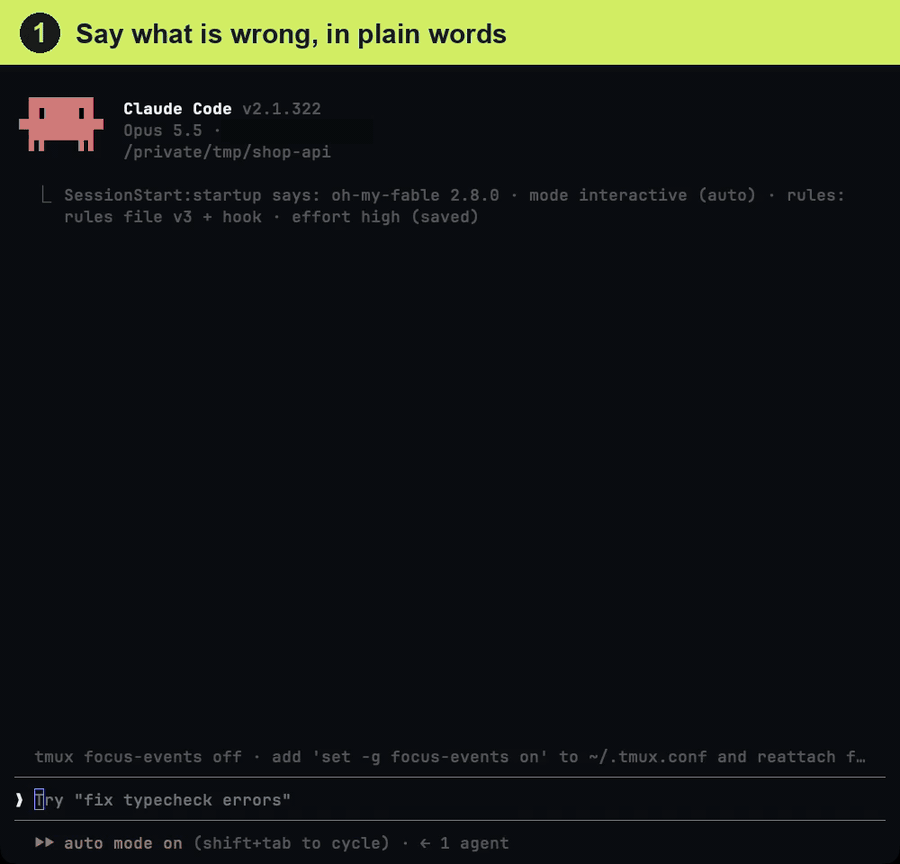

<div align="center" markdown="1">

# oh-my-fable

**A Claude Code plugin that applies the working rules from Anthropic's prompting guides for you**

Install it and every session gets the rules that fit it. `/fable` turns a rough request into goal, context, scope and done, then runs it.

[](https://github.com/Junhan2/oh-my-fable/blob/main/LICENSE)
[](https://github.com/Junhan2/oh-my-fable)
[](https://github.com/Junhan2/oh-my-fable/stargazers)
[](https://github.com/Junhan2/oh-my-fable/commits/main)

[한국어](README.md) · English · [中文](README.zh.md)

</div>

---

**Type a sloppy one-liner. Claude receives a proper request and runs it.**

👤 **What you type**
```
/fable the login button does nothing, fix it
```

🤖 **What Claude actually receives** (filled in from the conversation)
```
Goal: clicking the login button calls /api/login and, on success, navigates to /dashboard
Context: src/components/LoginButton.tsx, console error "TypeError: onSubmit is not a function", started after yesterday's auth change commit
Scope: this button and its handler only. Do not touch the signup form or other errors; report them as follow-ups
Done: reproduce the click and confirm navigation to /dashboard, 0 console errors, list of changed files attached
```

A real session, sped up in places (28 seconds). After the problem is described in plain words, the two words `/fable fix it` become a request card with goal, context, scope and done filled in from the conversation, and the work follows it.



## Install

Say this to Claude Code:

```
install https://github.com/Junhan2/oh-my-fable
```

Claude installs it and that is all. No questions, no config file. The rules apply automatically the next time you open Claude Code. To use them in this session right now, type `/reload-plugins` (loads the plugin you just installed) and then `/clear` (injects the rules), one per line.

To install by hand, run these two lines.

```bash
claude plugin marketplace add Junhan2/oh-my-fable
claude plugin install oh-my-fable@oh-my-fable
```

- **Requirements** · Claude Code 2.1.258 or newer. Windows needs Git for Windows (Git Bash).
- **Updating** · `claude plugin update oh-my-fable@oh-my-fable`, then a new session. What changed is in [CHANGELOG.md](CHANGELOG.md).
- **Removing** · `/fable-setup remove`, then `claude plugin uninstall oh-my-fable@oh-my-fable`.
- **Other environments** · The terminal, desktop app, IDE, `claude -p` and the Agent SDK need only the install. For CI, Cowork and cloud sessions see [By environment](docs/setup.en.md#by-environment).

## Usage

Just ask as you normally do; the always-on rules are already active. When a request is short or vague, prefix it:

```
/fable fix this
```

It shows a request with goal, context, scope, and done criteria filled in, then runs it. Add `just the prompt` to preview only.

| Command | When | What it does |
|---|---|---|
| `/fable` | a request is short or vague | shows the request with goal, context, scope and done filled in, then runs it |
| `/fable-status` | you wonder what is in effect | one table with version, where the rules live, mode and effort. Changes nothing |
| `/fable-audit` | you want to know what your rules are missing | checks CLAUDE.md and rules files against the guide. Read-only |
| `/fable-setup` | you want to change a default (optional) | moves the rules, pins a mode, checks for conflicting rules |

## What happens automatically

- **Always-on rules** · At every session start the official guides' rules are injected verbatim in English: autonomy, scope limits, deliver what was asked, targeted edits, progress updates, formatting, batched tool calls.
- **Unattended sessions** · Under `claude -p`, the Agent SDK or an agent harness the session is detected as unattended and gets the unattended paragraphs, only then. Mixing both needs no switching.
- **Subagents** · Subagents started with the Agent tool get a short version of the rules.
- **Request card** · The request `/fable` shows is drawn as a card in the transcript (the terminal on Claude Code 2.1.287 or newer, and the desktop app).
- **No files created** · CLAUDE.md and rules files stay untouched. With the default delivery, uninstalling leaves nothing behind.

## Supported models

Built for Opus 5.5 (Claude Code's current default model), Fable 5.2 and Fable 5.1. It works the same on Sonnet 5.5, Haiku 5.5, Opus 5 and Sonnet 5. What differs per model is in [How it works](docs/how-it-works.en.md#model-differences).

One hook and four skills apply the fixes from Anthropic's official [Prompting Claude Fable 5.2](https://platform.claude.com/docs/en/build-with-claude/prompt-engineering/prompting-claude-fable-5-2), [Prompting Claude Fable 5.1](https://platform.claude.com/docs/en/build-with-claude/prompt-engineering/prompting-claude-fable-5-1), [Prompting Claude Opus 5.5](https://platform.claude.com/docs/en/build-with-claude/prompt-engineering/prompting-claude-opus-5-5), and [Prompting Claude Opus 5](https://platform.claude.com/docs/en/build-with-claude/prompt-engineering/prompting-claude-opus-5), the guide the Opus 5.5 guide names as its own starting point. The wording stays almost word-for-word from the source.

## Learn more

| Page | What is in it |
|---|---|
| [How it works](docs/how-it-works.en.md) | the three layers, the table of rule blocks, settings, model differences |
| [Setup and environments](docs/setup.en.md) | what to do per environment, version requirements, changing where the rules live |
| [Symptom to fix](docs/symptoms.en.md) | symptoms such as stopping to ask or rewriting whole files, and the block for each |
| [FAQ](docs/faq.en.md) | install and remove, checking that it is on, the request card, other environments |
| [Layout and contributing](docs/contributing.en.md) | folder layout, files to change when a guide is updated |
| [CHANGELOG](CHANGELOG.md) | changes per version |

## Install steps Claude follows

The order Claude follows when it reads this README and installs the plugin. Skip it if you install by hand.

1. `claude plugin marketplace add Junhan2/oh-my-fable`
2. `claude plugin install oh-my-fable@oh-my-fable`
3. Read `installPath` for `oh-my-fable@oh-my-fable` from `~/.claude/plugins/installed_plugins.json`
4. Once the install is verified, tell the user only this: "Installed. The rules apply from the next session. To use them right now, type `/reload-plugins` and press Enter, then `/clear` and press Enter (one per line). Send vague requests as `/fable <request>`."
5. Say nothing else and do not run `/fable-setup` (it is optional; the defaults work without any configuration). Both commands are needed because `/reload-plugins` loads the just-installed plugin (hook and skills) into this session, and the rules are injected only on session start, `/clear`, and compaction. If the install output shows a `userConfig option not yet set` line, leave it alone (the request card is on by default; the FAQ says how to turn it off)

## License

MIT © Junhan2. The guide text itself is copyright Anthropic.
