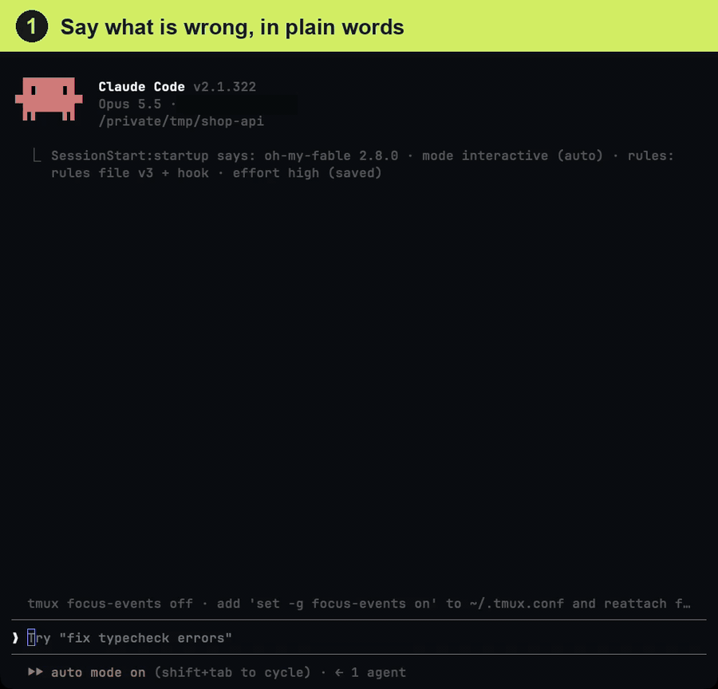

<div align="center" markdown="1">

# oh-my-fable

**Anthropic 프롬프팅 가이드의 작업 규칙을 Claude Code에 자동으로 넣어 주는 플러그인**

설치만 하면 세션마다 맞는 규칙이 들어가고, `/fable`은 막연한 요청을 목표·맥락·범위·완료 기준으로 바꿔 실행합니다.

[](https://github.com/Junhan2/oh-my-fable/blob/main/LICENSE)
[](https://github.com/Junhan2/oh-my-fable)
[](https://github.com/Junhan2/oh-my-fable/stargazers)
[](https://github.com/Junhan2/oh-my-fable/commits/main)

한국어 · [English](README.en.md) · [中文](README.zh.md)

</div>

---

**대충 한 줄로 시켜도, 제대로 된 요청으로 바뀌어 실행됩니다.**

👤 **당신이 치는 것**
```
/fable 로그인 버튼 눌러도 아무 반응 없어 고쳐줘
```

🤖 **Claude가 실제로 받는 요청** (대화 맥락에서 자동으로 채워짐)
```
목표: 로그인 버튼을 누르면 /api/login 이 호출되고, 성공하면 /dashboard 로 이동하게 한다
맥락: src/components/LoginButton.tsx, 콘솔 오류 "TypeError: onSubmit is not a function", 어제 인증 방식을 바꾼 커밋 이후 발생
범위: 이 버튼과 그 핸들러만. 옆의 회원가입 폼이나 다른 오류는 고치지 말고 후속 과제로 보고
완료 기준: 실제 클릭을 재현해 /dashboard 이동 확인, 콘솔 오류 0, 변경 파일 목록 첨부
```

실제 화면입니다(구간별로 속도를 높인 28초). 문제를 말로 설명한 뒤 `/fable fix it` 두 단어만 치면, 대화 맥락에서 목표·맥락·범위·완료 기준을 채운 요청 카드가 먼저 뜨고 그대로 실행합니다.



## 설치

Claude Code에 이렇게만 말하세요.

```
https://github.com/Junhan2/oh-my-fable 설치해줘
```

Claude가 설치하면 끝입니다. 질문도, 설정 파일도 없습니다. 다음에 Claude Code를 열면 자동으로 적용됩니다. 지금 이 세션에서 바로 쓰고 싶으면 `/reload-plugins`(방금 설치한 플러그인 로드) 다음 `/clear`(규칙 주입) 를 한 줄씩.

직접 설치하려면 아래 두 줄입니다.

```bash
claude plugin marketplace add Junhan2/oh-my-fable
claude plugin install oh-my-fable@oh-my-fable
```

- **요구 사항** · Claude Code 2.1.258 이상. Windows는 Git for Windows(Git Bash)가 있어야 합니다.
- **업데이트** · `claude plugin update oh-my-fable@oh-my-fable` 다음 새 세션. 바뀐 내용은 [CHANGELOG.md](CHANGELOG.md)에 있습니다.
- **제거** · `/fable-setup remove` 다음 `claude plugin uninstall oh-my-fable@oh-my-fable`.
- **다른 환경** · 터미널, 데스크톱 앱, IDE, `claude -p`, Agent SDK는 설치만 하면 됩니다. CI, Cowork, 클라우드 세션은 [환경별 안내](docs/setup.md#환경별-안내)를 보세요.

## 사용법

그냥 평소처럼 요청하면 됩니다. 상시 규칙은 이미 켜져 있습니다. 요청이 짧거나 막연하면 앞에 `/fable`을 붙이세요.

```
/fable 이거 좀 고쳐줘
```

목표·맥락·범위·완료 기준을 채운 요청을 보여 주고 바로 실행합니다. 보기만 하려면 뒤에 `프롬프트만`.

| 명령 | 언제 | 하는 일 |
|---|---|---|
| `/fable` | 요청이 짧거나 막연할 때 | 목표·맥락·범위·완료 기준을 채운 요청을 보여 주고 바로 실행 |
| `/fable-status` | 지금 뭐가 켜져 있는지 궁금할 때 | 버전, 규칙 위치, 모드, effort를 표 하나로 보여 줌. 아무것도 바꾸지 않음 |
| `/fable-audit` | 내 규칙에 가이드의 무엇이 빠졌는지 볼 때 | CLAUDE.md와 규칙 파일을 가이드와 대조. 읽기만 함 |
| `/fable-setup` | 기본값을 바꾸고 싶을 때(선택) | 규칙 위치 옮기기, 모드 고정, 기존 규칙과의 충돌 점검 |

## 자동으로 되는 것

- **상시 규칙** · 세션이 시작될 때마다 공식 가이드의 규칙을 영어 원문 그대로 넣습니다. 자율 진행, 범위 제한, 시킨 범위 그대로 끝내기, 부분 편집, 진행 보고, 서식, 도구 일괄 호출입니다.
- **무인 세션 감지** · `claude -p`, Agent SDK, 에이전트 하네스에서 열면 무인으로 감지해 무인용 문단을 그때만 더합니다. 터미널과 섞어 써도 바꿀 것이 없습니다.
- **서브에이전트** · Agent 도구로 띄운 서브에이전트에는 짧은 판을 따로 넣습니다.
- **요청 카드** · `/fable`이 보여 주는 요청을 대화 속 카드로 그립니다(터미널은 Claude Code 2.1.287 이상, 데스크톱 앱).
- **파일을 만들지 않음** · CLAUDE.md도 규칙 파일도 건드리지 않습니다. 기본 방식에서는 제거하면 흔적이 없습니다.

## 지원 모델

Opus 5.5(지금 Claude Code의 기본 모델), Fable 5.2, Fable 5.1을 기준으로 만들었습니다. Sonnet 5.5, Haiku 5.5, Opus 5, Sonnet 5에서도 그대로 씁니다. 모델마다 무엇이 다른지는 [작동 원리](docs/how-it-works.md#모델별-차이)에 있습니다.

Anthropic 공식 문서 [Prompting Claude Fable 5.2](https://platform.claude.com/docs/en/build-with-claude/prompt-engineering/prompting-claude-fable-5-2), [Prompting Claude Fable 5.1](https://platform.claude.com/docs/en/build-with-claude/prompt-engineering/prompting-claude-fable-5-1), [Prompting Claude Opus 5.5](https://platform.claude.com/docs/en/build-with-claude/prompt-engineering/prompting-claude-opus-5-5), 그리고 Opus 5.5 가이드가 출발점으로 지정한 [Prompting Claude Opus 5](https://platform.claude.com/docs/en/build-with-claude/prompt-engineering/prompting-claude-opus-5)의 처방을 훅 하나와 스킬 네 개에 담았습니다. 문구는 원문을 거의 그대로 씁니다.

## 더 알아보기

| 문서 | 내용 |
|---|---|
| [작동 원리](docs/how-it-works.md) | 세 층 구조, 규칙 블록 표, 설정값, 모델별 차이 |
| [설정과 환경](docs/setup.md) | 환경별 안내, 버전 요구 사항, 규칙 위치 바꾸기 |
| [증상별 처방](docs/symptoms.md) | "할까요?" 하고 멈춤, 파일 통째 재작성 같은 증상과 그에 맞는 블록 |
| [FAQ](docs/faq.md) | 설치와 제거, 켜져 있는지 확인, 요청 카드, 다른 실행 환경 |
| [구성과 기여](docs/layout.md) | 폴더 구조, 가이드가 갱신될 때 고칠 파일 |
| [CHANGELOG](CHANGELOG.md) | 버전별 변경 내용 |

## Claude가 따르는 설치 절차

Claude가 이 README를 읽고 설치할 때 따르는 순서입니다. 직접 설치한다면 읽지 않아도 됩니다.

1. `claude plugin marketplace add Junhan2/oh-my-fable`
2. `claude plugin install oh-my-fable@oh-my-fable`
3. `~/.claude/plugins/installed_plugins.json` 에서 `oh-my-fable@oh-my-fable` 의 `installPath` 를 읽는다
4. 설치가 확인되면 사용자에게 이렇게만 안내한다: "설치가 끝났습니다. 다음 세션부터 자동 적용됩니다. 지금 바로 쓰려면 `/reload-plugins` 를 입력하고 Enter, 그다음 `/clear` 를 입력하고 Enter 하세요(한 줄에 하나씩). 막연한 요청은 `/fable <요청>` 으로 보내세요."
5. 그 밖의 설명은 하지 않고 `/fable-setup` 도 실행하지 않는다(선택 사항이며 기본값은 설정 없이 동작). 둘 다 필요한 이유: `/reload-plugins` 는 방금 설치한 플러그인(훅·스킬)을 이 세션에 로드하고, 규칙 주입은 세션 시작·`/clear`·압축 때만 일어난다. 설치 출력에 `userConfig option not yet set` 줄이 보여도 따로 설정하지 않는다(요청 카드는 기본으로 켜져 있고, 끄는 방법은 FAQ에 있다)

## 라이선스

MIT © Junhan2. 가이드 원문의 저작권은 Anthropic에 있습니다.
