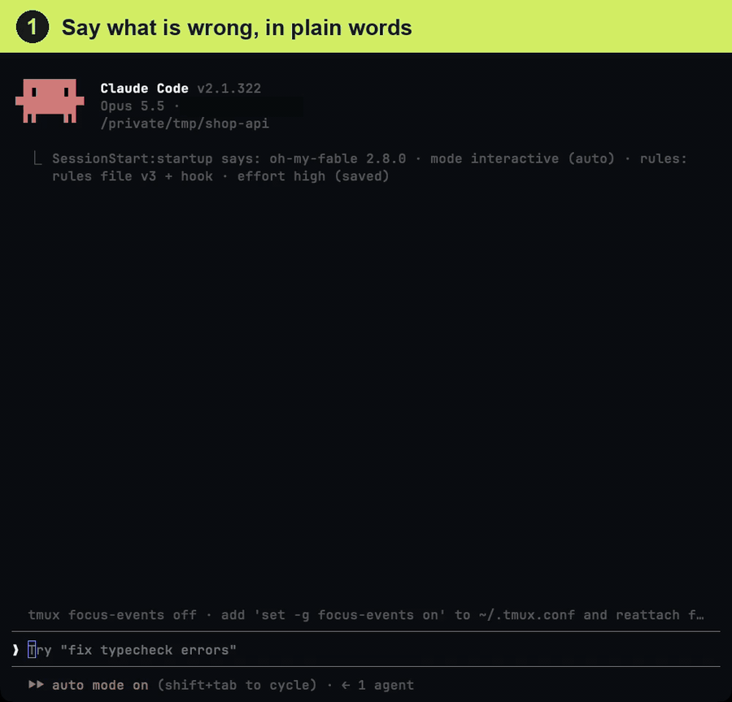

<div align="center" markdown="1">

# oh-my-fable

**把 Anthropic 提示指南的工作规则自动加入 Claude Code 的插件**

装上之后，每个会话都自动拿到合适的规则；`/fable` 会把模糊的请求补全为目标、上下文、范围和完成标准再执行。

[](https://github.com/Junhan2/oh-my-fable/blob/main/LICENSE)
[](https://github.com/Junhan2/oh-my-fable)
[](https://github.com/Junhan2/oh-my-fable/stargazers)
[](https://github.com/Junhan2/oh-my-fable/commits/main)

[한국어](README.md) · [English](README.en.md) · 中文

</div>

---

**随手一句话，也会变成完整的请求并直接执行。**

👤 **你输入的**
```
/fable 登录按钮点了没反应，帮我修一下
```

🤖 **Claude 实际收到的请求**（从对话上下文自动补全）
```
目标：点击登录按钮时调用 /api/login，成功后跳转到 /dashboard
上下文：src/components/LoginButton.tsx，控制台错误 "TypeError: onSubmit is not a function"，昨天改认证方式的提交之后出现
范围：只改这个按钮和它的处理函数。旁边的注册表单和其他错误不要修，作为后续事项汇报
完成标准：实际复现点击并确认跳转到 /dashboard，控制台错误 0，附上改动文件列表
```

真实会话，部分片段加速（28 秒）。先用大白话说明问题，再输入 `/fable fix it` 两个词，就会先出现一张根据对话填好目标、上下文、范围和完成标准的请求卡片，然后按它执行。



## 安装

对 Claude Code 说：

```
安装 https://github.com/Junhan2/oh-my-fable
```

Claude 装好就结束了。没有提问，也没有配置文件。下次打开 Claude Code 时自动生效。想在当前会话立即使用，先输入 `/reload-plugins`（加载刚安装的插件），再输入 `/clear`（注入规则），每行一个。

想手动安装，运行这两行。

```bash
claude plugin marketplace add Junhan2/oh-my-fable
claude plugin install oh-my-fable@oh-my-fable
```

- **环境要求** · Claude Code 2.1.258 及以上。Windows 需要 Git for Windows（Git Bash）。
- **更新** · `claude plugin update oh-my-fable@oh-my-fable`，然后开新会话。改动内容见 [CHANGELOG.md](CHANGELOG.md)。
- **卸载** · 先运行 `/fable-setup remove`，再运行 `claude plugin uninstall oh-my-fable@oh-my-fable`。
- **其他环境** · 终端、桌面应用、IDE、`claude -p` 和 Agent SDK 只需安装。CI、Cowork、云端会话请看[按环境](docs/setup.zh.md#按环境)。

## 用法

像平时一样提出请求即可，常驻规则已经生效。请求简短或模糊时在前面加：

```
/fable 帮我修一下这个
```

它会展示补全了目标、上下文、范围和完成标准的请求并直接执行。只想预览，在后面加 `只要提示词`。

| 命令 | 何时 | 做什么 |
|---|---|---|
| `/fable` | 请求简短或模糊时 | 展示补全了目标、上下文、范围和完成标准的请求并直接执行 |
| `/fable-status` | 想知道当前生效了什么时 | 一张表：版本、规则位置、模式、effort。不做任何修改 |
| `/fable-audit` | 想知道自己的规则缺了指南的哪些内容时 | 把 CLAUDE.md 和规则文件对照指南。只读 |
| `/fable-setup` | 想改默认值时（可选） | 移动规则位置、固定模式、检查冲突规则 |

## 自动完成的事

- **常驻规则** · 每次会话开始时按英文原文注入官方指南的规则：自主执行、范围限制、按要求交付、局部编辑、进度汇报、排版、批量工具调用。
- **无人值守会话** · 在 `claude -p`、Agent SDK、代理框架中打开时识别为无人值守，只在那时追加无人值守段落。混用也无需切换。
- **子代理** · 用 Agent 工具启动的子代理会收到精简版规则。
- **请求卡片** · 把 `/fable` 展示的请求在对话中画成卡片（终端需 Claude Code 2.1.287 或更新，桌面应用同样支持）。
- **不创建文件** · 不碰 CLAUDE.md 和规则文件。默认方式下卸载不留痕迹。

## 支持的模型

以 Opus 5.5（Claude Code 目前的默认模型）、Fable 5.2、Fable 5.1 为基准。在 Sonnet 5.5、Haiku 5.5、Opus 5、Sonnet 5 上同样适用。各模型的差异见[工作原理](docs/how-it-works.zh.md#模型差异)。

把 Anthropic 官方文档 [Prompting Claude Fable 5.2](https://platform.claude.com/docs/en/build-with-claude/prompt-engineering/prompting-claude-fable-5-2)、[Prompting Claude Fable 5.1](https://platform.claude.com/docs/en/build-with-claude/prompt-engineering/prompting-claude-fable-5-1)、[Prompting Claude Opus 5.5](https://platform.claude.com/docs/en/build-with-claude/prompt-engineering/prompting-claude-opus-5-5)，以及 Opus 5.5 指南指定为起点的 [Prompting Claude Opus 5](https://platform.claude.com/docs/en/build-with-claude/prompt-engineering/prompting-claude-opus-5) 的处方，装进一个钩子和四个技能。提示词模块原文基本照用。

## 了解更多

| 文档 | 内容 |
|---|---|
| [工作原理](docs/how-it-works.zh.md) | 三层结构、规则模块表、设置项、模型差异 |
| [设置与环境](docs/setup.zh.md) | 按环境的做法、版本要求、更改规则存放位置 |
| [症状对处方](docs/symptoms.zh.md) | 中途停下询问、重写整个文件等症状及对应模块 |
| [常见问题](docs/faq.zh.md) | 安装与移除、确认是否生效、请求卡片、其他运行环境 |
| [结构与贡献](docs/layout.zh.md) | 目录结构、指南更新时要改的文件 |
| [CHANGELOG](CHANGELOG.md) | 各版本的改动 |

## Claude 执行的安装步骤

Claude 读取本 README 并安装插件时遵循的顺序。自己手动安装的话可以跳过。

1. `claude plugin marketplace add Junhan2/oh-my-fable`
2. `claude plugin install oh-my-fable@oh-my-fable`
3. 从 `~/.claude/plugins/installed_plugins.json` 读取 `oh-my-fable@oh-my-fable` 的 `installPath`
4. 确认安装后只告诉用户："安装完成。下次会话自动生效。现在就用请输入 `/reload-plugins` 并回车，再输入 `/clear` 并回车（每行一个）。模糊的请求用 `/fable <请求>` 发送。"
5. 不做其他说明，也不运行 `/fable-setup`（它是可选的，默认值无需任何配置即可工作）。两者都需要：`/reload-plugins` 把刚安装的插件（钩子和技能）加载到本会话，而规则只在会话开始、`/clear` 和压缩时注入。安装输出里出现 `userConfig option not yet set` 一行时不必另行设置（请求卡片默认开启，关闭方法见 FAQ）

## 许可

MIT © Junhan2。指南原文版权归 Anthropic 所有。
